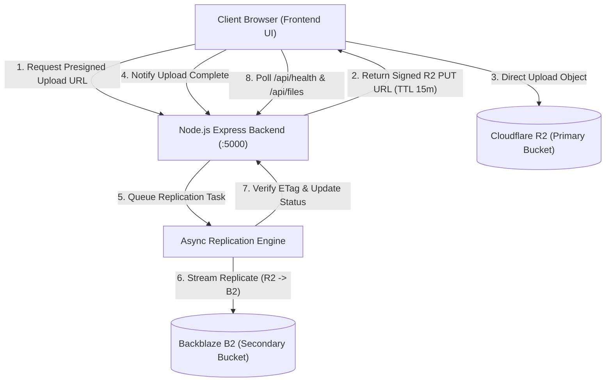

# System Architecture: Multi-Cloud Backup System

## 1. High-Level Overview

---

## 2. Component Architecture

### A. Frontend Layer (Existing & Preserved)
- **Files**: `index.html`, `script.js`, `style.css`
- **Responsibilities**:
  - Live dashboard with provider health status pills (`#primaryCloudStatus`, `#secondaryCloudStatus`).
  - Drag-and-drop file ingest zone with upload progress indicators.
  - Stored objects table showing dual-cloud synchronization state, file sizes, and timestamps.
  - Failover drill trigger (`#simulateDrillBtn`) and sync trigger (`#syncAllBtn`).
  - Architecture modal (`#archModal`) and delete confirmation modal (`#deleteModal`).
  - **Zero Credentials**: The frontend contains zero cloud credentials; all requests route through `http://localhost:5000/api`.

### B. Backend API Gateway (To be implemented in Phase 2)
- **Runtime**: Node.js v24+ Express
- **Port**: `5000` (Path: `/api`)
- **Core Endpoints**:
  - `GET /api/health`: Aggregated health of primary and secondary storage, file count, and synchronization %.
  - `GET /api/files`: Lists objects, their primary/secondary presence, and replication status.
  - `POST /api/upload`: Validates file size (max 50 MB) and issues presigned `PUT` URL for Cloudflare R2.
  - `POST /api/sync`: Manually triggers synchronization for any pending or out-of-sync objects.
  - `POST /api/drill`: Toggles simulated primary outage state to test failover behavior.
  - `DELETE /api/files/:fileName`: Coordinates safe dual-cloud deletion.
  - `GET /api/files/:fileName/download`: Minted presigned `GET` URL (routes to R2 normally, or B2 during failover).
  - `GET /api/files/:fileName/verify`: Recomputes and compares ETags between R2 and B2.

### C. Cloud Storage Layer
1. **Primary: Cloudflare R2**
   - Protocol: S3-Compatible API (`https://<account_id>.r2.cloudflarestorage.com`)
   - Bucket Policy: 100% Private (No public access)
   - Advantage: Zero egress fees for user downloads and replication reads.
2. **Secondary: Backblaze B2**
   - Protocol: S3-Compatible API (`https://s3.<region>.backblazeb2.com`)
   - Bucket Policy: 100% Private
   - Advantage: Extremely low storage cost ($0.006/GB/month) for redundant disaster recovery.

---

## 3. Security & Threat Modeling

| Threat | Mitigation Strategy |
| :--- | :--- |
| **Credential Exfiltration** | Cloud API keys reside only in server-side `.env`, never in frontend or git. |
| **Public Data Exposure** | Both buckets are strictly private; public read ACLs are disabled. |
| **Unauthorized Uploads** | Presigned URLs are tied to specific object keys, valid for max 15 minutes, and capped at 50 MB. |
| **Man-in-the-Middle** | TLS 1.3 enforced for all S3 and API communications. |
| **Accidental Data Loss** | Soft-delete / deletion confirmation modals, plus multi-cloud redundancy. |
